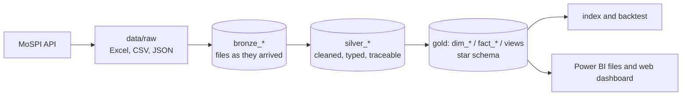

# India Economic Pulse

> Can UPI, GST and fuel data give an early read on Indian industrial output before the official IIP? A data pipeline, SQL database, index and honest backtest, built from public government data.

## Headline result
**Partly, and the honest answer matters more than a flattering one.** Fuel and GST growth track official IIP growth closely when activity swings widely (diesel r = 0.85, gross GST r = 0.84 over 2019-26, still 0.83 and 0.64 without COVID months), and a simple index built from them cut forecast error by 18 to 21% against a 12-month-average baseline over 66 scored months. In calm periods it did **not**: on the current IIP series (29 scored months) the baseline was better (error 1.88 points vs 1.98 for the best index version), and scored only from Apr 2022 every index version lost to the baseline. UPI growth carries no signal (r = 0.1): it measures adoption, not activity.
Read the one-page [memo](docs/memo.md), the [notebook](notebooks/03_index_and_backtest.ipynb) or the [data-quality log](docs/data_quality_log.md).

**[Interactive dashboard](https://omegazerog.github.io/india-economic-pulse/)** (headline, indicator drill-down and backtest scorecard; each chart names its data file). Rebuild it with `python src/export_dashboard.py` then `python src/build_site.py`; it is served from `docs/index.html` by GitHub Pages.

<!-- Add the Power BI headline screenshot here:  -->

## Data sources
| Source | Link | Frequency | Release lag | Loaded |
|---|---|---|---|---|
| UPI volume and value (NPCI) | [npci.org.in](https://www.npci.org.in/product/upi/product-statistics) | monthly | ~1 day | Apr 2017 - Sep 2026 |
| Petroleum consumption (PPAC) | [ppac.gov.in](https://ppac.gov.in/consumption/products-wise) | monthly | ~1 week | Apr 2000 - Sep 2026 |
| GST collections, state-wise (GSTN) | [gst.gov.in](https://www.gst.gov.in/download/gststatistics) | monthly | ~1 day | Jul 2017 - Aug 2026 |
| E-way bills (GSTN) | [gst.gov.in](https://www.gst.gov.in/download/gststatistics) | monthly | ~1 month | Jul 2018 - Aug 2026 |
| IIP, the target (MoSPI) | [eSankhyiki](https://esankhyiki.mospi.gov.in/macroindicators?product=iip) | monthly | ~28 days | base 2022-23 from Apr 2023; base 2011-12 to Mar 2026 |
| Quarterly GDP (MoSPI) | [eSankhyiki](https://esankhyiki.mospi.gov.in/macroindicators?product=nas) | quarterly | ~60 days | Q1 FY23 - Q1 FY27 |

UPI, PPAC and GST sites block scripts, so those files are **downloaded by hand** into `data/raw` (dated file names). IIP and GDP come from MoSPI's open API. **Refreshing is manual; nothing updates by itself.** Full details and every known problem: [`docs/data_inventory.md`](docs/data_inventory.md).

## Run it (three commands)
```bash
pip install -r requirements.txt
python src/run_all.py            # bronze -> silver -> gold in data/pulse.db, 7 SQL checks, then the index and backtest
python src/export_powerbi.py     # CSV files for the Power BI report (see powerbi/REPORT_GUIDE.md)
```

## Architecture: bronze, silver, gold

- **Bronze** keeps every raw file cell by cell with its name, date and hash, and cleans nothing. Re-running skips unchanged files.
- **Silver** parses bronze into typed tables (units as published, first-of-month keys, missing months left missing). Every row records the file it came from.
- **Gold** is the star schema (date dimension plus one fact table per indicator) built from silver with plain SQL, plus the growth views.
- Seven SQL checks run across the layers after every build. Details and a lineage example: [`docs/architecture.md`](docs/architecture.md).

## Method in five lines
1. Raw files are never edited. Each layer is rebuilt from the one below by `python src/run_all.py`.
2. `sql/gold_load.sql` fills the star schema in SQLite; `sql/views.sql` computes year-on-year growth with `LAG(value, 12)`; `sql/checks.sql` runs the checks after every build.
3. Year-on-year growth, not levels, so seasonality and trend drop out.
4. Three indices, simplest first: equal-weight z-score average, first principal component, small ridge regression, each fitted only on earlier months.
5. A rolling-origin backtest (fit on the past, forecast the next month, move on) scores every index against two naive baselines (last value, 12-month average) on the same months.

## Backtest results
Mean absolute error in percentage points; improvement is against the better naive baseline.

| Sample | Scored months | 12-month baseline | z-score index | PCA | Regression |
|---|---|---|---|---|---|
| Current IIP (base 2022-23), 7 indicators | 29 | 1.88 | 1.98 (-5%) | 2.07 (-10%) | 2.32 (-24%) |
| Old IIP, Apr 2019 - Mar 2026, COVID excluded, no UPI | 66 | 3.42 | 2.70 (+21%) | 2.88 (+16%) | 2.79 (+18%) |
| Same models, scored from Apr 2022 | 48 | 2.46 | 2.85 (-16%) | 2.96 (-20%) | 2.62 (-6%) |
| Same models, scored from Apr 2023 | 36 | 1.85 | 2.25 (-21%) | 2.35 (-27%) | 2.16 (-17%) |

Robustness variants and lag tests: `docs/results/`.

## Limitations
- The current IIP series is short (41 months) and correlates only 0.40 with the old one over 36 overlapping months, so they are reported separately, never joined.
- Small samples: differences of a few percent are within noise. An early 29-month result that looked positive reversed with more data; it is recorded in the quality log.
- Recent GST and fuel figures are provisional. October-November comparisons are distorted when Diwali moves between months (flagged in `dim_date`).
- Net GST exists only from Apr 2020 (no refund data earlier), so the long-sample runs use gross GST excluding cess.
- Forecast tooling (`src/analysis/forecast.py`, draft in `docs/forecasts/`) is included to show the method; no live forecast or track record is claimed.
- Data comes from public Indian government and statutory sources (NPCI, PPAC, GSTN, MoSPI), used here for non-commercial analysis. Check each site's terms before redistributing the raw files.

## Folder map
| Folder | Contents |
|---|---|
| `data/raw` | Downloaded files, never edited, download date in the file name |
| `src/bronze` | Load raw files into the database as they arrived; fetch IIP and GDP from the API |
| `src/silver` | One parser per source: bronze to cleaned tables |
| `src/gold` | Build the star schema and growth views from silver |
| `src/analysis` | Index, lag tests, backtest (`pulse.py`, `run_week3.py`) and the forecast tool |
| `sql` | Bronze, silver and gold schemas, the gold load, growth views, data-quality checks |
| `notebooks` | `03_index_and_backtest.ipynb`: findings, lag tests, backtest, robustness |
| `powerbi` | CSV exports, DAX measures and the report build guide |
| `docs` | Architecture, memo, data inventory, data-quality log, results, forecast draft |
