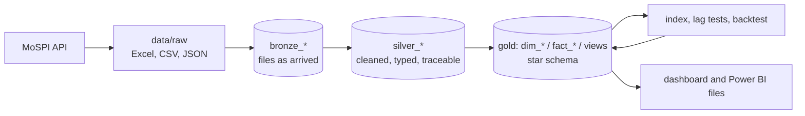
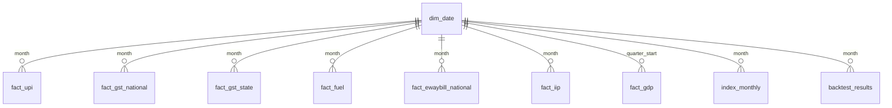

# India Economic Pulse

> Can UPI, GST and fuel data give an early read on Indian industrial output before the official figure is published? A bronze-silver-gold data pipeline, a SQL star schema, an activity index and an honest out-of-sample backtest, built from public government data.

**Links:** [interactive dashboard](https://omegazerog.github.io/india-economic-pulse/) · [one-page memo](docs/memo.md) · [analysis notebook](notebooks/03_index_and_backtest.ipynb) · [architecture](docs/architecture.md) · [data-quality log](docs/data_quality_log.md) · [data inventory](docs/data_inventory.md)

## Contents
1. [The 30-second version](#1-the-30-second-version)
2. [The problem and why it matters](#2-the-problem-and-why-it-matters)
3. [Key terms](#3-key-terms)
4. [Headline results](#4-headline-results)
5. [Data sources and how they were obtained](#5-data-sources-and-how-they-were-obtained)
6. [Architecture: bronze, silver, gold](#6-architecture-bronze-silver-gold)
7. [Data cleaning and quality](#7-data-cleaning-and-quality)
8. [SQL design](#8-sql-design)
9. [Analysis method](#9-analysis-method)
10. [Detailed results](#10-detailed-results)
11. [Dashboard, Power BI kit and forecast tool](#11-dashboard-power-bi-kit-and-forecast-tool)
12. [Design decisions and why](#12-design-decisions-and-why)
13. [Limitations](#13-limitations)
14. [What would come next](#14-what-would-come-next)
15. [How to run it](#15-how-to-run-it)
16. [Repository map](#16-repository-map)

---

## 1. The 30-second version
India publishes its official industrial output figure (the **IIP**) about 28 days after each month ends. Payments (UPI), tax collections (GST), fuel sales and goods movement (e-way bills) are published much sooner. This project asks whether those faster indicators can tell us if industrial output is speeding up or slowing down before the IIP arrives.

What was built: a pipeline that loads six public data sources into a layered SQLite database, cleans them with every decision logged, builds a star schema with SQL, constructs an activity index, and tests it honestly against naive baselines.

What was found: **fuel and GST growth track the IIP closely when activity swings widely, and a simple index built from them beat a plain 12-month average over 2019 to 2026. In calm periods it did not.** On the current IIP series, a plain 12-month average was better than every index version. UPI growth carries no signal. The index is an early warning for large changes, not a more precise forecaster in a calm month.

## 2. The problem and why it matters
A finance, consulting or research team that wants to know "is the economy speeding up or slowing down?" cannot wait a month for the official figure. Faster proxies exist, but a proxy is only useful if it is tested: does it move with the official number, and does it beat the simplest guess you could make without it?

The simplest guesses (the **baselines**) were fixed before any model was built:
- last month's IIP growth;
- the average of the last 12 months of IIP growth.

An index has to beat these on months it was not fitted to, or it adds nothing. That test, not the correlation, is the project's centre.

## 3. Key terms
| Term | Meaning |
|---|---|
| **IIP** | Index of Industrial Production: the official monthly measure of output from mining, manufacturing and electricity, published by MoSPI about 28 days after month end. The target here. |
| **Year-on-year (YoY) growth** | A month's value compared with the same month a year earlier. Removes seasonality and trend, and makes indicators comparable. |
| **UPI** | Unified Payments Interface: India's instant digital payment system. Monthly transaction volume and value (NPCI). |
| **GST** | Goods and Services Tax. Monthly collections, national and by state (GSTN). |
| **E-way bill** | An electronic document required to move goods above a value threshold. A proxy for goods movement. |
| **PPAC fuel data** | Monthly consumption of petrol, diesel, jet fuel (ATF), LPG and bitumen. Diesel tracks freight, bitumen road construction, ATF air travel. |
| **Cess** | A compensation levy added to some GST. It ended in March 2026, which creates a break in GST totals. |
| **MAE** | Mean absolute error: the average size of a forecast miss, in percentage points of IIP growth. Lower is better. |
| **Rolling-origin backtest** | For each month: fit using only earlier data, forecast that month, move forward. The model never sees the month it is scored on. |
| **Z-score** | A value minus its average, divided by its spread, so indicators on different scales can be averaged. |
| **PCA** | Principal component analysis: finds the single combination of indicators that carries the most shared movement. |
| **Bronze / silver / gold** | Three data layers: raw as it arrived, cleaned and typed, and modelled for reporting. |

## 4. Headline results
| Question | Answer |
|---|---|
| Do fuel and GST growth move with IIP growth? | **Yes over 2019-26**: diesel r = 0.85, petrol 0.86, gross GST 0.84. With COVID months removed: 0.83, 0.71, 0.64. |
| Does UPI? | **No**: r = 0.11 (volume) and 0.09 (value). UPI growth reflects adoption, not activity. |
| Did the index beat a 12-month average over 2019-26? | **Yes**: error 18 to 21% lower over 66 scored months (COVID months excluded, UPI left out). Direction right in 64 to 69% of months. |
| Did it beat it on the current IIP series? | **No**: 29 scored months, error 1.88 points for the baseline against 1.98 (z-score), 2.07 (PCA) and 2.32 (regression). |
| Does the edge survive in calm periods? | **No**: scored from Apr 2022 every index version was 6 to 20% worse than the baseline; from Apr 2023, 17 to 27% worse. |
| Is the result stable? | **No**, and that is reported: it changes sign under reasonable alternative choices (see [section 10](#10-detailed-results)). |

An early version of the analysis, with only 29 usable months, looked positive (a small regression 2% better than the baseline, diesel r = 0.48). After extending the data history it reversed. The reversal is documented in the [quality log](docs/data_quality_log.md) rather than hidden.

## 5. Data sources and how they were obtained
| Source | What | Frequency | Release lag | Loaded | How obtained |
|---|---|---|---|---|---|
| [NPCI](https://www.npci.org.in/product/upi/product-statistics) | UPI volume and value | monthly | ~1 day | Apr 2017 - Sep 2026 (114 months) | Excel download per financial year; the site blocks scripts |
| [PPAC](https://ppac.gov.in/consumption/products-wise) | Petrol, diesel, ATF, LPG, bitumen consumption | monthly | ~1 week | Apr 2000 - Sep 2026 | Excel download (historical and current report) |
| [GSTN](https://www.gst.gov.in/download/gststatistics) | GST by state, national totals | monthly | ~1 day | Jul 2017 - Aug 2026 (110 months, 39 states and UTs) | Excel download per financial year; firewall blocks scripts |
| [GSTN](https://www.gst.gov.in/download/gststatistics) | E-way bills by state | monthly | ~1 month | Jul 2018 - Aug 2026 (98 months) | Excel download per financial year |
| [MoSPI IIP](https://esankhyiki.mospi.gov.in/macroindicators?product=iip) | The target | monthly | ~28 days | Base 2022-23: Apr 2023 - Aug 2026 (41 months). Base 2011-12: Apr 2012 - Mar 2026 (168 months) | Open API, no key |
| [MoSPI GDP](https://esankhyiki.mospi.gov.in/macroindicators?product=nas) | Quarterly real and nominal GDP | quarterly | ~60 days | Q1 FY23 - Q1 FY27 (17 quarters) | Open API, no key |

Three of the sites reject scripted requests, so those files are **downloaded by hand** and saved in `data/raw` with the download date in the name. The IIP and GDP APIs are called by `src/bronze/fetch_api.py`; the server needs a legacy-TLS workaround that is applied to that host only. **Refreshing is manual: nothing updates by itself.** Per-source detail and known problems: [`docs/data_inventory.md`](docs/data_inventory.md).

## 6. Architecture: bronze, silver, gold

All three layers live in one SQLite file, separated by table prefix.

| Layer | Tables | Rule |
|---|---|---|
| **Bronze** | `bronze_files`, `bronze_cells`, `bronze_api` | Every raw file stored as it arrived, one row per non-empty cell or JSON record, with file name, date, type, size and SHA-256 hash. **Nothing is cleaned.** A file with the same name and hash is skipped; changed content is reloaded and logged. |
| **Silver** | `silver_upi`, `silver_fuel`, `silver_gst_national`, `silver_gst_state`, `silver_ewaybill_state`, `silver_iip`, `silver_gdp` | Typed rows, units as published, first-of-month date keys, state names conformed by state code, missing months left missing. Every row records its `source_file`. Rebuilt in full from bronze each run. |
| **Gold** | `dim_date`, `fact_*`, views `v_*`, `index_monthly`, `backtest_results`, `forecast_log` | The star schema reporting reads. Facts are filled from silver with plain SQL. |

Current size: **35 raw files, 108,846 bronze records**; silver 114 UPI months, 1,590 fuel rows, 110 national and 4,264 state GST rows, 3,702 e-way bill state rows, 209 IIP rows, 17 GDP rows.

**Lineage:** any number can be traced to the raw cells it came from (example queries in [`docs/architecture.md`](docs/architecture.md)). A Python loader or SQL step can be re-run safely because each layer is rebuilt from the one below. When the pipeline was restructured from raw → clean CSV → star schema into this layout, all 16 gold tables, analysis tables and views were compared with the old build: every cell matched (differences at most 1e-9, floating-point noise).

## 7. Data cleaning and quality
Real government files are messy. The [data-quality log](docs/data_quality_log.md) records about 50 issues, fixes and decisions in date order. The ones that matter most:

| Problem | What was done |
|---|---|
| UPI files saved as `.csv` were actually Excel workbooks | File type is detected from the file's bytes, not its extension |
| PPAC "historical" file is a workbook with one sheet per fiscal year, not one table; fiscal year is read from a "Period" cell | Parser loops over sheets and derives calendar months from the fiscal year |
| GST state workbooks FY2023-24 and FY2024-25 have a CESS column; later ones do not | Columns are found by header name, not position. A first attempt read the wrong columns and was **caught by a cross-check** against the national file |
| Compensation cess ended in Mar 2026, so gross GST has a structural break | Growth uses CGST + SGST + IGST (ex-cess), which is consistent across the break |
| GST workbooks before FY2020-21 have no refund data | Refunds and net GST are left blank, never estimated. The long-sample analysis uses gross GST |
| The national GST workbook only reaches back to Apr 2023 | Earlier national months are built from the All-India sheet of the state workbooks, validated on 41 overlapping months to within 0.01% |
| July 2017, the first GST month, is almost empty | Kept as published; excluded from growth by starting the long sample in Apr 2019 |
| An Excel header layout changed in one sheet (extra "Daily" column; one sheet missing a heading) | Sheet-specific detection, logged |
| MoSPI **rebased** the IIP to 2022-23; the old and new growth rates correlate only 0.40 over 36 overlapping months | The two series are **never joined**. The new one is the target; the old one is a robustness test |
| MoSPI's API needs legacy TLS renegotiation | Adapter applied to that host only |
| UPI growth in 2018-20 is explosive adoption | UPI is kept in the main index but left out of the long-sample runs, where it carries no signal |

**Seven SQL checks** run after every build (`sql/checks.sql`): no missing months in any table; no negative volumes or collections; state GST totals equal the national domestic total within 0.5%; gold row counts equal silver; year-on-year growth stays in a plausible range; every bronze file loaded fully; every silver row traces to an existing bronze file. The first five were also shown to fail on deliberately corrupted data (a deleted month, a negative value, a doubled state, an extra row, a spiked value). The GST loader reconciles 330 comparisons across 110 months, all within 0.5%.

Spot checks against widely reported figures also pass, for example UPI July 2026 = 23.66 billion transactions / Rs 29.88 lakh crore, April 2020 GST gross = Rs 32,172 crore (the COVID low), and diesel September 2026 growth +5.6%, the same as PPAC's own note.

## 8. SQL design
**Star schema** (gold): one date dimension and one fact table per indicator, joined on the first day of the month.


`dim_date` carries year, month, days in month, fiscal year and quarter (April to March), a Diwali-month flag, a festive-season flag and a COVID flag. IIP and GDP keep **every version** of a number with the date it was observed, so a revision is a new row, not an overwrite.

**Year-on-year growth** is computed once, in a view, with a window function:
```sql
SELECT month, indicator, value,
       CASE WHEN LAG(month, 12) OVER w = date(month, '-12 months')
            THEN 100.0 * (value / LAG(value, 12) OVER w - 1) END AS yoy_pct
FROM base
WINDOW w AS (PARTITION BY indicator ORDER BY month);
```
The `CASE` guard matters: `LAG(…, 12)` means "twelve rows back", which is only twelve months back if no month is missing. If a month is missing, the guard returns NULL instead of a wrong comparison.

Other SQL: `v_iip_latest` (the latest observed version of each month), `v_backtest_summary` (the scorecard), and the silver-to-gold load in `sql/gold_load.sql` (including the national e-way bill total, within-state plus outgoing so incoming bills are not counted twice).

## 9. Analysis method
1. **Panel.** Year-on-year growth for seven indicators: average daily UPI volume, UPI value, net GST, diesel, bitumen, jet fuel, petrol. (E-way bills and LPG are available but tested as variants.) Average daily volume is used so February's shorter month does not distort UPI.
2. **Timing.** The indicators for month *t* are all published before the IIP for month *t*, so the model may use month *t*'s indicators. The last IIP known is month *t-1*'s.
3. **Baselines, fixed first.** Last value, and 12-month average. Both scored by MAE on the same months as every model.
4. **Lag tests.** Correlation of each indicator's growth at *t-k* with IIP growth at *t*, for k = 0, 1, 2, plus -1 (the indicator one month *after*, not available at forecast time). Run with and without COVID months, and with the sample start moved by 0, 3 and 6 months to see if a result depends on the start date.
5. **Three index versions, simplest first.**
   - *Equal-weight z-score index:* standardise each indicator, average them, map the average to IIP growth with a one-variable regression.
   - *PCA index:* first principal component of the standardised indicators, sign fixed so it rises with IIP.
   - *Small regression:* a ridge regression on the two indicators most correlated with IIP **in the training months only**.
6. **Rolling-origin backtest.** For each month, every step (standardisation, PCA loadings, indicator selection, regression weights) is fitted only on earlier months, then the month is forecast. Minimum training window 12 months. No model is ever scored on data it was fitted to.
7. **Metrics.** MAE and RMSE, direction hit rate (did the model call the sign of the change from last month correctly?), and MAE improvement against the better baseline: (baseline MAE − model MAE) ÷ baseline MAE. A reference: simply repeating last month's direction is right only about 33% of the time, because IIP growth tends to reverse.
8. **Two samples.** The *main* sample uses the current IIP (base 2022-23): 41 months with all seven indicators, 29 scored (Apr 2024 - Aug 2026). The *long* sample uses the old IIP (base 2011-12): 83 months (Apr 2019 - Mar 2026), 66 scored, with the COVID shock (Apr-Jun 2020) and its base effect (Apr-Jun 2021) removed from training and scoring. Net GST starts only in Apr 2020, so the long sample uses gross GST.

## 10. Detailed results
**Correlation of year-on-year growth with IIP growth (old IIP series, lag 0).**

| Indicator | All months Apr 2019 - Mar 2026 | COVID months removed | Since Apr 2022 | Since Apr 2023 (calm) |
|---|---|---|---|---|
| Diesel | 0.85 | 0.83 | 0.63 | 0.54 |
| Petrol | 0.86 | 0.71 | 0.56 | -0.23 |
| GST gross (ex-cess) | 0.84 | 0.64 | 0.41 | -0.06 |
| Jet fuel (ATF) | 0.67 | 0.52 | 0.45 | 0.32 |
| Bitumen | 0.48 | 0.46 | 0.50 | 0.69 |
| UPI daily volume | 0.11 | 0.01 | 0.42 | 0.39 |
| UPI value | 0.09 | -0.06 | 0.42 | 0.38 |

The strong links come from the big 2020-22 swings. In the calm period they weaken or flip, and UPI's later correlation reflects its trend, not activity. On the current IIP series (41 months) the lag-0 correlations are much weaker: diesel 0.17, GST net 0.29, UPI value 0.24. GST published a month *after* an IIP month correlates 0.32 with it (GST reflects the previous month's activity), but that data is not out in time to forecast with.

**Backtest, current IIP series (29 scored months, Apr 2024 - Aug 2026).**

| Model | MAE (points) | Direction right | vs better baseline |
|---|---|---|---|
| Last month's value | 2.24 | n/a | -19.2% |
| **12-month average** | **1.88** | 71% | 0.0% |
| Z-score index | 1.98 | 75% | -5.3% |
| PCA index | 2.07 | 75% | -10.2% |
| Regression | 2.32 | 61% | -23.6% |

**Long sample (old IIP series), and the same models scored only on later months.**

| Scoring window | Scored months | 12-month baseline | Z-score | PCA | Regression |
|---|---|---|---|---|---|
| Apr 2019 - Mar 2026, COVID removed, UPI left out | 66 | 3.42 | 2.70 (+21%) | 2.88 (+16%) | 2.79 (+18%) |
| Same models, scored from Apr 2022 | 48 | 2.46 | 2.85 (-16%) | 2.96 (-20%) | 2.62 (-6%) |
| Same models, scored from Apr 2023 | 36 | 1.85 | 2.25 (-21%) | 2.35 (-27%) | 2.16 (-17%) |

**Robustness (current IIP series).** Change in error against the better baseline:

| Variant | Months | Z-score | PCA | Regression |
|---|---|---|---|---|
| Main: 7 indicators, 12-month minimum training | 29 | -5.3% | -10.2% | -23.6% |
| Adding e-way bills as an 8th indicator | 29 | **+15.4%** | -7.8% | -24.3% |
| Minimum training 10 months | 31 | -4.9% | -5.8% | -18.9% |
| Minimum training 15 months | 26 | +7.2% | +0.4% | -17.8% |
| Scoring excluding Diwali-shift months | 27 | -10.6% | -15.6% | -26.9% |

How to read this: one variant (adding e-way bills) beat the baseline, and a longer minimum training window helped the z-score index, so there is a hint of signal, but the sign changes with reasonable choices, so none of it is a reliable edge. That e-way variant was not chosen in advance; picking it now would be choosing the best-looking result after the fact, so the main model stays as defined.

**PCA weights** (first component, 46% of variance): UPI volume 0.53, UPI value 0.53, jet fuel 0.50, GST net 0.34, bitumen 0.26, diesel 0.08, petrol 0.02. UPI carries the most weight although it has the weakest link to IIP, one reason the PCA index is hard to defend.

**Interpretation.** The index detects *large changes* in activity. For small month-to-month moves, a plain 12-month average is hard to beat. The honest recommendation is to use the indicators as an early warning, checked against the IIP when it arrives, and not as a replacement for the baseline.

## 11. Dashboard, Power BI kit and forecast tool
- **Web dashboard** ([live](https://omegazerog.github.io/india-economic-pulse/), source `src/site/template.html`, built into `docs/index.html` by `src/build_site.py`): three tabs (headline, indicators, backtest scorecard). Each chart names the data file behind it. Charts are drawn with d3; the page works on a phone.
- **Power BI kit** (`powerbi/`): CSV exports of the star schema (`python src/export_powerbi.py`), DAX measures (`measures.dax`) and a step-by-step report guide (`REPORT_GUIDE.md`). The measures and guide are written but not run in Power BI Desktop in this repository.
- **Forecast tool** (`src/analysis/forecast.py`): fits the z-score index on all earlier months, forecasts a target month next to the 12-month-average baseline, takes intervals from the backtest errors, and writes a draft file in `docs/forecasts/`. Its `--final` mode refuses to write unless every indicator for the target month is published, the git tree is clean and no file for that version exists. It also records a GDP call (Q2 FY27 growth below Q1's 7.82%, low confidence, from how Q2's level has compared with Q1's in four earlier years). **No live forecast or track record is claimed**; the October 2026 file is an illustrative draft.

## 12. Design decisions and why
| Decision | Reason |
|---|---|
| Year-on-year growth, not levels | Removes seasonality and trend; avoids a false correlation between two rising series |
| Baselines fixed before any model | Stops the yardstick moving after seeing results |
| Rolling-origin, not a single split | Uses every month as a test once, and never scores a model on data it was fitted to |
| Everything (selection, standardisation, weights) fitted on earlier months only | Prevents look-ahead leakage, the commonest hidden error in backtests |
| Two IIP series kept separate | Rebasing changed growth materially (correlation 0.40); joining them would be inventing a series |
| Missing values left missing, never filled | A filled gap looks like data and hides the problem |
| UPI left out of the long-sample runs | It measured adoption, not activity (r ≈ 0.1); including it worsened the z-score index from +21% to -6% |
| Reported the result that reversed | The early positive result was a small-sample artefact; saying so is more useful than a flattering number |
| Bronze-silver-gold on a small dataset | The data is small, but the pattern gives lineage, safe re-runs and a way to prove a refactor changed nothing |
| SQLite | Free, file-based, enough for this volume; window functions and views work as in larger systems |

## 13. Limitations
- **Short history for the current IIP series** (41 months). It cannot be joined to the old one (correlation 0.40 over 36 overlapping months).
- **Small samples**: 29 to 66 scored months. Differences of a few percent are within noise.
- **Regime dependence**: the index has skill when activity swings widely and none in calm conditions, which is where the latest data sits.
- **Provisional data**: recent GST and fuel figures are revised. IIP and GDP versions are stored with the date they were observed; fuel and GST are re-downloaded and replaced.
- **Diwali timing** moves between October and November and distorts year-on-year comparisons in both. The Diwali months in `dim_date` are entered from a festival calendar and should be re-verified before reuse.
- **Net GST** exists only from Apr 2020, so the long sample uses gross GST.
- **UPI growth** reflects adoption as well as activity.
- **Manual refresh**: three sources must be downloaded by hand, so the project is not real-time.
- **Licence**: data comes from public Indian government and statutory sources (NPCI, PPAC, GSTN, MoSPI), used here for non-commercial analysis. Check each site's terms before redistributing the raw files.

## 14. What would come next
- A festival (Diwali) adjustment, and state-level indicators matched to state output.
- Retest once the current IIP series has 60+ months.
- A model that blends the index with the baseline, evaluated by the same rolling backtest.
- Automating the downloads where the sites allow, and a scheduled refresh.

## 15. How to run it
Requires Python 3.11+.
```bash
pip install -r requirements.txt
python src/run_all.py              # bronze -> silver -> gold, 7 SQL checks, then the index and backtest
python src/run_all.py --api        # same, after pulling the latest IIP and GDP from MoSPI
python src/export_powerbi.py       # CSV files for Power BI
python src/export_dashboard.py && python src/build_site.py   # rebuild the web dashboard (docs/index.html)
```
`data/pulse.db` is not committed; `run_all.py` rebuilds it from `data/raw` in about a minute.

**Refreshing with new data:** download the new month's files by hand into `data/raw` with the download date in the file name (`upi_FY2026-27_YYYY-MM-DD.xlsx`, `gst_state_FY2026-27_...`, `ppac_current_...`, `ewaybill_FY2026-27_...`), then run `python src/run_all.py --api`. Bronze loads only the new or changed files.

**Publishing the dashboard:** repository Settings → Pages → Deploy from a branch → `main` → `/docs`.

## 16. Repository map
```
data/raw/                 downloaded files, never edited, download date in each name
sql/
  bronze_schema.sql       raw-file tables
  silver_schema.sql       cleaned tables
  gold_schema.sql         star schema and analysis tables
  gold_load.sql           silver -> gold, in SQL
  views.sql               growth, latest IIP, backtest scorecard
  checks.sql              the 7 data checks
src/
  bronze/                 load_bronze.py (files -> bronze), fetch_api.py (IIP, GDP)
  silver/                 one parser per source, build_silver.py
  gold/                   build_gold.py (dimension, facts, views, checks)
  analysis/               pulse.py (index, lag tests, backtest), run_week3.py, forecast.py
  run_all.py, run_checks.py, common.py
  export_powerbi.py, export_dashboard.py, build_site.py, site/template.html
notebooks/                03_index_and_backtest.ipynb: findings, lag tests, backtest, robustness
powerbi/                  CSV exports, DAX measures, report guide, dashboard data
docs/                     memo, architecture, data inventory, data-quality log, results, forecast draft, index.html (dashboard)
```
