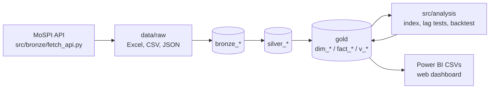

# Architecture: bronze, silver, gold

The project follows the medallion pattern. Raw files are stored first and never cleaned on the way in; cleaning happens in a separate, rebuildable layer; reporting reads a star schema built from that.



## The layers

| Layer | Tables | Built by | What it guarantees |
|---|---|---|---|
| **Bronze** | `bronze_files`, `bronze_cells`, `bronze_api` | `src/bronze/load_bronze.py` | Every raw file exactly as it arrived: one row per non-empty cell (value as text, plus whether it was a number, date or text) or per JSON record, with the file's name, download date, type, size and SHA-256 hash. Nothing is cleaned or renamed. The file type is detected from the bytes, so an Excel file saved as `.csv` loads correctly. |
| **Silver** | `silver_upi`, `silver_fuel`, `silver_gst_national`, `silver_gst_state`, `silver_ewaybill_state`, `silver_iip`, `silver_gdp` | `src/silver/*.py` | One typed row per month (and state, product or IIP version). Units as published and named in the column, first-of-month date keys, state names conformed by state code, missing months left missing. Every row has a `source_file`. Emptied and rebuilt in full from bronze on every run. |
| **Gold** | `dim_date`, `fact_*`, views `v_*`, analysis tables `index_monthly`, `backtest_results`, `forecast_log` | `sql/gold_load.sql`, `sql/views.sql`, `src/gold/build_gold.py` | The star schema reporting reads. Facts are refilled from silver with plain SQL, so gold always equals silver. Year-on-year growth is computed once, in a view, with `LAG(value, 12)` guarded so a missing month gives NULL rather than a wrong comparison. |

All three layers live in one SQLite file (`data/pulse.db`, not committed; one command rebuilds it). SQLite has no schemas, so layers are separated by table prefix.

## Rules each layer follows
- **Bronze is faithful and idempotent.** A file with the same name and hash is skipped; changed bytes under the same name are reloaded and logged; a bronze file whose raw file was removed is dropped. Re-running changes nothing unless the raw folder changed.
- **Silver is disposable.** Because it is rebuilt entirely from bronze, a parsing fix is applied by re-running, never by editing data.
- **Gold is a full refresh.** No hand edits; no row that silver does not have.
- **Lineage.** Any number can be traced back to the bytes it came from.
- **Checks at each layer.** `sql/checks.sql` holds seven: no missing months, no negative values, state totals equal national, gold row counts equal silver, growth in a plausible range, every bronze file fully loaded, every silver row traceable to a bronze file.

## Lineage example: where did September 2026 UPI come from?
```sql
-- 1. gold -> silver: the row and the file it came from
SELECT month, volume_mn, source_file FROM silver_upi WHERE month = '2026-09-01';

-- 2. silver -> bronze: that file's hash, type and load time
SELECT file_name, file_date, file_type, sha256, loaded_at FROM bronze_files WHERE file_name = 'upi_FY2026-27_2026-10-21.csv';

-- 3. the raw cells for that month, exactly as stored
SELECT row_num, col_num, cell_type, value_text FROM bronze_cells
WHERE file_id = (SELECT file_id FROM bronze_files WHERE file_name = 'upi_FY2026-27_2026-10-21.csv') AND row_num = 1;
```

## How a refresh works
1. Download the new month's files by hand into `data/raw`, with the download date in the name (IIP and GDP: `python src/bronze/fetch_api.py`).
2. `python src/run_all.py`. Bronze loads only the new files; silver and gold are rebuilt from bronze; the checks and the analysis run.

## Why this design for a small project
About 110,000 raw cells and a few thousand cleaned rows do not need three layers. The pattern is used here for what it buys at any size: the raw data is never lost or silently changed, every cleaning decision lives in code that can be re-run, any number is traceable, and a bug fix is a re-run rather than a repair. At larger volumes the same layers would sit in Parquet or Delta tables, with the silver step in Spark or dbt; the structure would not change.

## What changed in the move to this design
The first version went raw file, then cleaned CSV, then the star schema. The rebuilt pipeline reproduces every gold table, analysis table and view of that version (all cells equal, differences at most 1e-9, which is floating-point noise), so no result changed.
